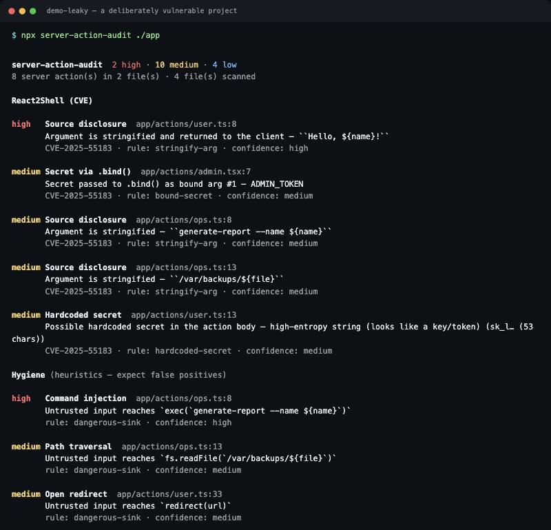
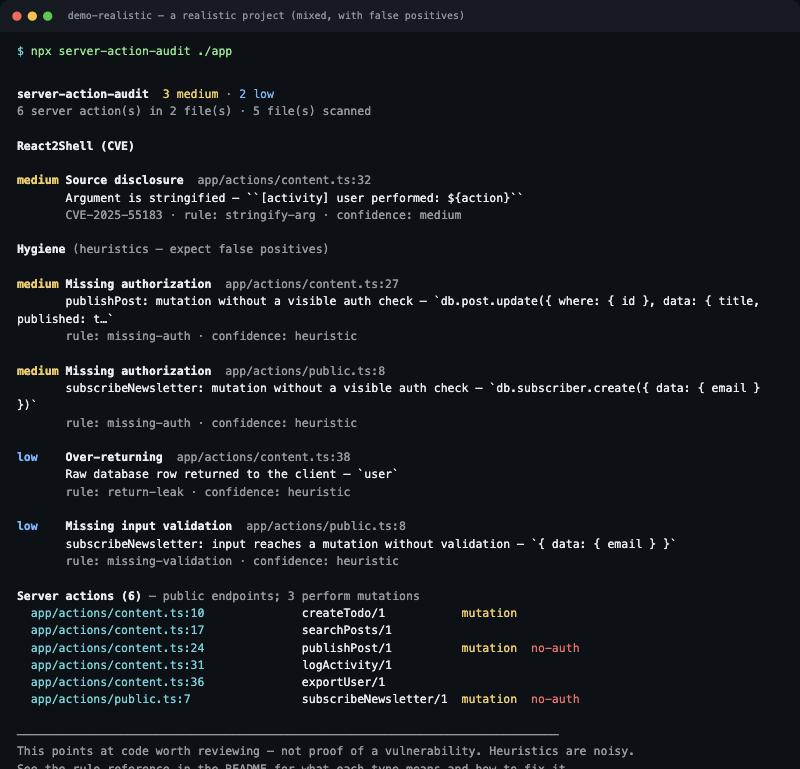
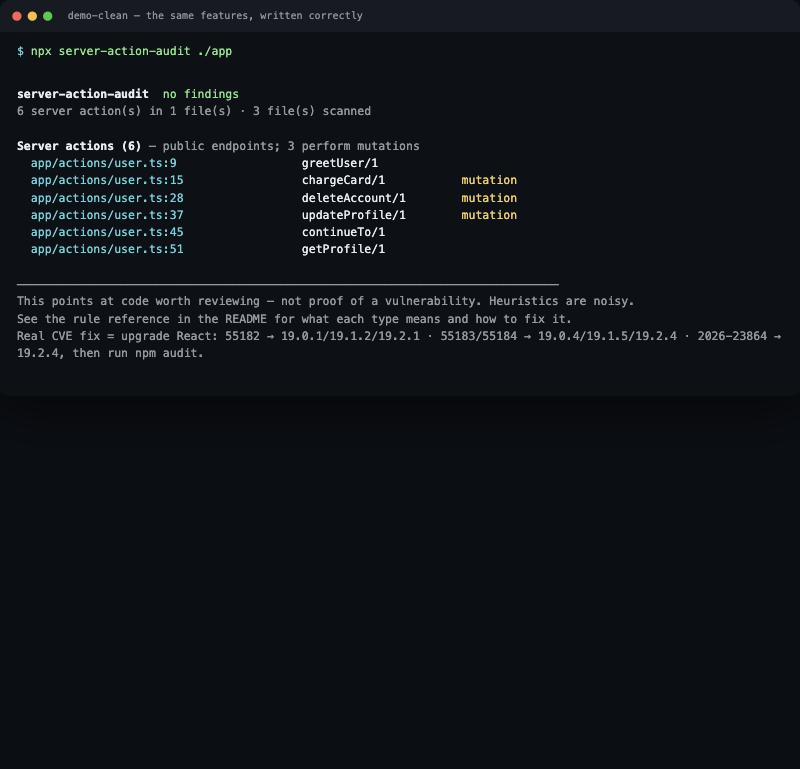

# server-action-audit

Static analysis of **Server Action code** (React Server Components / Next.js App Router).
It points at code worth reviewing in relation to the **React2Shell** family of vulnerabilities
(CVE-2025-55182 / 55183 / 55184), plus common Server Action hygiene issues.

> A companion tool for the HolyJS talk *"Welcome to the server: where vulnerabilities hide in the
> Next.js App Router."*

## What it is NOT

It is **not a version scanner**. `npm audit`, Dependabot and Snyk already do that — and the only
real fix for the CVEs themselves is a **React upgrade** (see below). This tool does what version
auditing can't: it reads the AST of your Server Actions and flags risky patterns in the code.

It is also **not proof of a vulnerability**. It shows you *where to look*. The heuristics are noisy
and false positives are expected — a deliberate trade-off toward "rather show too much."

## Run

No install, via `npx` (once the repository is public):

```bash
npx github:startpointforl/react2shell-nextjs-materials ./path/to/your-app
```

Or locally from this repository:

```bash
npm run build        # TypeScript → dist/
node dist/cli.js ../../your-app
```

By default it scans `app` and `src` (if present), otherwise the current directory.

## Example output

A deliberately vulnerable project — findings across all rules:



A realistic project — a mix of real signals and honest false positives (a public-by-design
endpoint, a custom-named auth helper the tool doesn't recognize):



The same features written correctly — no findings, exit 0:



## Options

```
--format <fmt>       text | json                    (default: text)
-o, --output <file>  write the report to a file
--no-heuristics      CVE rules only (skip the "Hygiene" section)
--fail-on <sev>      non-zero exit on findings >= severity: high|medium|low (default: high)
--audit              also run `npm audit` and print the summary
--no-color           disable ANSI color
```

Exit codes: `0` — clean (below threshold), `1` — findings >= `--fail-on`, `2` — startup error.

`--format json` emits the full findings as machine-readable JSON — handy for piping into an AI
assistant that explains each finding in plain language.

## How to read a finding

Each finding carries a **confidence** label:

- **high** — the pattern is almost certainly the one in question (still not proof of a hole);
- **medium** — the pattern is there, but the full picture (data flow, context) isn't visible;
- **heuristic** — a guess from names and code shape; false positives are expected here.

The text report stays terse on purpose (type, one line, a dim `CVE · rule · confidence` line). The
full meaning and fix for each type live in the **rule reference** below — handy when you run the
tool through an AI assistant that explains each finding in plain language.

## Rule reference

### React2Shell (CVE)

#### `stringify-arg` — Source disclosure · CVE-2025-55183
A Server Action stringifies its argument (`String(arg)`, a template literal, `arg + ''`,
`.toString()`). **high** when the result is returned to the client — this is exactly the
CVE-2025-55183 exploit condition: passing a *server-function reference* instead of a string makes
React serialize and return that function's source. **medium** when the stringification is there but
the return to the client isn't visible.
**Fix:** upgrade React and validate the argument type before use (`typeof` / zod).

#### `hardcoded-secret` — Hardcoded secret · CVE-2025-55183
A string literal that looks like a key/token (high Shannon entropy, or a `SECRET`/`KEY`/`TOKEN`-like
name) **inside** the action body. Source disclosure exposes literals baked into the function source;
a `process.env` value is **not** exposed this way. (The reported value is masked so the report
itself doesn't leak it.)
**Fix:** move the secret to an environment variable (not `NEXT_PUBLIC_`) and upgrade React.

#### `bound-secret` — Secret via .bind() · CVE-2025-55183
A secret reaches the client through `action.bind(null, secret)` or is captured by an inline action's
closure. Bound arguments are serialized and sent to the client — encrypted with the build key, but
off the server; a leaked build key exposes them.
**Fix:** read the secret from `process.env` inside the action instead of binding/capturing it.

### Hygiene (heuristics — expect false positives)

#### `dangerous-sink` — Code execution / Command injection / SSRF / Open redirect / Path traversal / SQL injection
Action input reaches, without validation, a dangerous sink: `eval` / `new Function` (code
execution), `child_process.exec`/`spawn` (command injection), `fetch` / `new URL` (SSRF), `redirect`
(open redirect), `fs.*` file APIs (path traversal), or `$queryRawUnsafe` / `sql.raw` (SQL
injection).
**Fix:** validate/allow-list the input, or use the safe API (parameterized queries, `execFile`
without a shell, relative-path-only redirects). *Note: named `fs` imports like `import { readFile }`
aren't recognized — only `fs.readFile`-style calls.*

#### `mass-assignment` — Mass assignment
The whole input object is written to the database (`{ data: input }`,
`Object.fromEntries(formData)`). The client can add extra fields (`role`, `isAdmin`) and escalate.
**Fix:** write only explicit allow-listed fields (zod `.pick` / destructuring).

#### `return-leak` — Over-returning
The action returns a raw DB row (no `select`) or an error's `message`/`stack`. Unlike *thrown*
errors, *returned* values aren't masked by Next.js, so internal fields and stack traces leak.
**Fix:** return a DTO with explicit fields; log errors server-side and return a generic message.

#### `missing-auth` — Missing authorization
A mutation (`db.*.create/update/delete`, `fetch` POST) with no visible auth check before it. A
Server Action is a public endpoint — anyone can POST to it by id.
**Fix:** check the session/permissions at the start (`auth()`, `getSession()`, `requireUser()`) or
wrap the action in auth middleware. *Custom-named helpers may not be recognized → false positives.*

#### `missing-validation` — Missing input validation
An argument reaches a mutation without validation (`zod .parse`, `typeof`, `Number()`, a schema
wrapper).
**Fix:** validate input with a schema or explicit coercion before use.

Plus an **endpoint map** in the report: every Server Action found (these are public endpoints), with
`mutation` / `no-auth` flags, and `name/N` where N is the argument count.

## Suppressing a finding

```ts
// server-action-audit-ignore-next-line stringify-arg
return `Hello ${name}`
```

Without a rule id, all rules on that line are suppressed. Variants:
`server-action-audit-ignore`, `-ignore-next-line`, `-ignore-line` (current line).

## Limitations (honestly)

- Analysis is **intra-procedural and single-file**. If an argument flows into another module and is
  stringified there, the tool won't see it.
- ORM (`db`/`prisma`/`drizzle`/…) and auth functions are recognized **by name**. Unusual naming
  causes both misses and false positives.
- The `missing-auth` / `missing-validation` / `mass-assignment` / `return-leak` heuristics are the
  noisiest. Turn the whole section off with `--no-heuristics`.
- The tool **does not execute** your code and does not resolve types — it reads syntax only.

## The real CVE fix — upgrade React

| CVE | Type | Fixed in |
|---|---|---|
| CVE-2025-55182 | RCE | React 19.0.1 / 19.1.2 / 19.2.1 |
| CVE-2025-55183 | source disclosure | 19.0.4 / 19.1.5 / 19.2.4 |
| CVE-2025-55184 | DoS | 19.0.4 / 19.1.5 / 19.2.4 |
| CVE-2026-23864 | DoS | 19.2.4 |

After upgrading, run `npm audit` (or the tool with `--audit`).

## Development

```bash
npm install
npm test             # vitest over fixtures (bad/ must fire, good/ must stay clean)
npm run build
```

Parsing uses `@typescript-eslint/typescript-estree` (ESTree AST, no type-checker). Detectors are
pure functions over the AST in `src/rules/`, which keeps the door open for an ESLint plugin built on
the same core.

```
src/
  ast.ts, taint.ts, patterns.ts   — utilities, intra-procedural taint, pattern recognition
  actions.ts                      — Server Action discovery (module-level 'use server' and inline)
  rules/                          — one file per rule
  report/                         — text / json
  scan.ts, cli.ts                 — project walk and CLI
```

## Disclaimer

Built for an **educational security talk**. It guarantees neither completeness nor the absence of
false positives. Run it **on your own code** and verify findings by hand.
